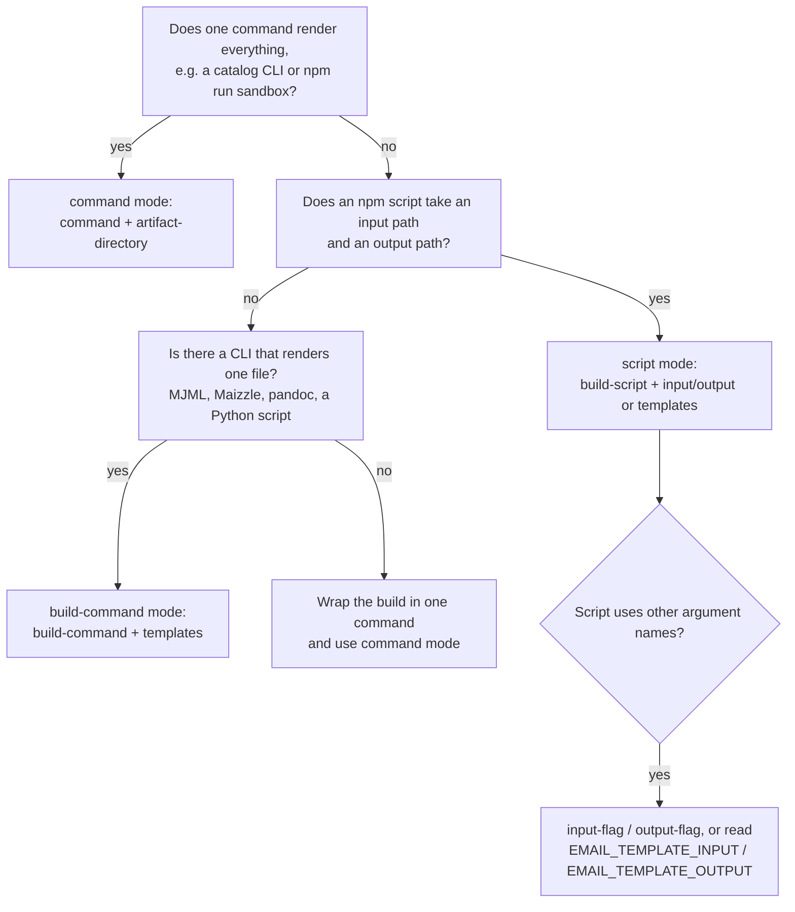

# Agent playbook

How to add `LLazyEmail/email-template-workflows@v1` to a repository, step by step. Written for AI coding agents; humans will find it useful too.

If you are changing **this** repository instead, read [`AGENTS.md`](../AGENTS.md).

## What the Action does, in one paragraph

It is a GitHub composite Action. In a workflow job it detects the package manager, installs the project's dependencies, runs the project's own build to turn email sources (Markdown, MJML, Lit, anything) into HTML files, writes an `index.html` that links them, uploads the folder as a workflow artifact, writes a job summary, and on a pull request posts or updates one comment. It does **not** build templates itself, send email, lint HTML for email-client compatibility, or comment outside pull requests. Your job is to point it at the build the project already has.

```
detect package manager → set up Node + Corepack/Bun → install → prebuild-command
  → render (command | build-command | <pm> run build-script, once per template)
  → index.html, rendered.txt, failed.txt, job summary → upload artifact → PR comment
  → fail the job if any template failed (only with fail-fast: false)
```

## The procedure

Do these four steps in order. Do not skip step 1: wrong workflows usually come from guessing instead of looking.

### Step 1: Inspect the repository

Look for facts. Each one maps to a decision below.

| Look for | Command | Tells you |
| --- | --- | --- |
| Where `package.json` is | `git ls-files '**/package.json'` | `working-directory` (use `.` if it is at the root) |
| Lockfile | `ls pnpm-lock.yaml yarn.lock bun.lock bun.lockb package-lock.json 2>/dev/null` | package manager (auto-detected; set `package-manager` only to override) |
| `packageManager` field | `grep packageManager package.json` | package manager and version |
| Build scripts | `node -e 'console.log(require("./package.json").scripts)'` | `build-script`, `validate-script`, or a `command` |
| Node version file | `ls .nvmrc .node-version .tool-versions 2>/dev/null` | `node-version-file` |
| Source templates | `git ls-files '*.mjml' '*.md' '*.mdx' '*.hbs' '*.njk'` and the folder names | `templates` or `input` paths |
| Where HTML is written | read the build script or config for the output folder | `output`, `artifact-directory` |
| Private packages | `cat .npmrc`; look for `@scope:registry=` | `registry-url`, `registry-scope`, `packages: read` |
| Existing workflows | `ls .github/workflows` and read any that already render emails | do not create a duplicate; edit the existing one |
| Monorepo markers | `pnpm-workspace.yaml`, `workspaces` in `package.json`, `turbo.json`, `nx.json` | lockfile is at the root, `working-directory` is a package |

Run the build locally if you can, with the exact command you are about to give the Action. If it does not work on your machine, it will not work in CI.

### Step 2: Choose the render mode

Follow the first row that matches.



| Mode | Set | The Action runs | Use when |
| --- | --- | --- | --- |
| Command | `command`, `artifact-directory` | the command once; indexes every `*.html` under `artifact-directory` at any depth | one command renders a whole folder |
| Script | `build-script` plus `input`+`output` or `templates` | `<pm> run <build-script> --input X --output Y` per template | an npm script takes input and output paths |
| Build-command | `build-command` plus `templates` or `input`+`output` | your shell command per template, with `$EMAIL_TEMPLATE_INPUT` and `$EMAIL_TEMPLATE_OUTPUT` | the tool is not an npm script |

Precedence, when several are set: `command` beats `build-command` beats `build-script`; `templates` beats `input`+`output`; `validate-command` beats `validate-script`. Do not set conflicting inputs on purpose; the lower ones are silently ignored.

### Step 3: Write the workflow

Start from this skeleton and fill the marked parts. Everything not marked is deliberate.

```yaml
name: Render emails

on:
  pull_request:
  push:
    branches: [main]

permissions:
  contents: read
  pull-requests: write      # drop this line (and set pr-comment: false) if you do not want the comment

jobs:
  render:
    runs-on: ubuntu-latest
    steps:
      - uses: actions/checkout@v7
      - uses: LLazyEmail/email-template-workflows@v1
        with:
          working-directory: .          # FILL: folder with package.json
          # FILL: the render mode inputs from step 2
          artifact-directory: generated # FILL: folder the HTML is written to
          artifact-name: rendered-email
```

Rules that apply to every workflow:

1. `actions/checkout` comes first.
2. Set `working-directory` explicitly. Its default, `generated`, is almost never right.
3. All path inputs (`input`, `output`, `templates`, `artifact-directory`) are relative to `working-directory`. `node-version-file` is the exception: it is relative to the repository root.
4. `artifact-directory` must be the folder the build really writes to.
5. In a matrix, or when calling the Action more than once in a job, give every call its own `artifact-name`, and either set `pr-comment: false` or give each call its own `comment-key`.
6. Keep secrets out of inputs. Pass them through the job or step `env:`.
7. Pin `@v1`, never `@main`. Add `# vX.Y.Z` and a commit SHA only if the repository already pins actions by SHA.

### Step 4: Verify

1. The YAML parses: `python3 -c "import yaml,sys; yaml.safe_load(open(sys.argv[1]))" .github/workflows/render-emails.yml` (or `actionlint` if installed).
2. Every script named in `build-script` or `validate-script` exists in the `package.json` that `working-directory` points at.
3. Every path in `templates` / `input` exists: `git ls-files <path>`.
4. The `artifact-directory` matches where the build writes.
5. Permissions: `contents: read`, plus `pull-requests: write` only if the comment is wanted, plus `packages: read` for private GitHub Packages.
6. Open a pull request. The run should show an artifact named `artifact-name`, a job summary listing the files, and **one** `### Rendered emails` comment.

Do not report success until step 6 has happened, or tell the user plainly that it has not.

## Recipes

Each recipe shows only the Action call; wrap it in the skeleton above. All of them are checked against `action.yml` in CI, so they use real inputs.

### An npm script that takes `--input` and `--output`

```yaml
- uses: LLazyEmail/email-template-workflows@v1
  with:
    working-directory: .
    build-script: build-email
    templates: |
      src/welcome.md:generated/welcome.html
      src/invoice.md:generated/invoice.html
    validate-script: ""             # no validate-email script in this project
    artifact-directory: generated
```

### A script with different argument names

```yaml
- uses: LLazyEmail/email-template-workflows@v1
  with:
    working-directory: .
    build-script: render
    input-flag: --src=              # passes --src=<path>; "--src" passes --src <path>; "" passes the path alone
    output-flag: --dest=
    input: emails/welcome.md
    output: dist/welcome.html
    validate-script: ""
    artifact-directory: dist
```

A script that reads its paths from the environment needs no flags at all: `EMAIL_TEMPLATE_INPUT` and `EMAIL_TEMPLATE_OUTPUT` are always set.

### MJML, Maizzle, pandoc or any other CLI

```yaml
- uses: LLazyEmail/email-template-workflows@v1
  with:
    working-directory: .
    templates: |
      emails/welcome.mjml:dist/welcome.html
      emails/invoice.mjml:dist/invoice.html
    build-command: npx mjml "$EMAIL_TEMPLATE_INPUT" -o "$EMAIL_TEMPLATE_OUTPUT"
    validate-script: ""
    artifact-directory: dist
```

Always quote `$EMAIL_TEMPLATE_INPUT` and `$EMAIL_TEMPLATE_OUTPUT`. Do not paste the paths into the command yourself; the variables are what make it work for every template.

### A tool that is not installed on the runner

Install it in a step before the Action. `skip-install: true` skips the Node dependency install when the project has no `package.json`.

```yaml
- run: sudo apt-get update && sudo apt-get install -y pandoc
- uses: LLazyEmail/email-template-workflows@v1
  with:
    working-directory: .
    skip-install: true
    templates: |
      emails/welcome.md:dist/welcome.html
    build-command: pandoc --standalone "$EMAIL_TEMPLATE_INPUT" -o "$EMAIL_TEMPLATE_OUTPUT"
    validate-script: ""
    artifact-directory: dist
```

Node.js must still be on `PATH`, because the Action uses it to index the output. Leave `setup-node` at its default, or install Node yourself and set `setup-node: false`.

### One command renders everything (a catalog)

```yaml
- uses: LLazyEmail/email-template-workflows@v1
  with:
    working-directory: .
    command: npx generate-template --all --out=generated
    artifact-directory: generated
```

### A pnpm, yarn or bun project

Usually nothing to add: the package manager is detected from `packageManager`, then the lockfile. To enforce the lockfile or pin a version:

```yaml
- uses: LLazyEmail/email-template-workflows@v1
  with:
    working-directory: .
    package-manager: pnpm
    package-manager-version: "10.28.0"
    install-command: pnpm install --frozen-lockfile
    cache: auto
    build-script: build-email
    input: src/welcome.md
    output: generated/welcome.html
    validate-script: ""
```

### A monorepo

The lockfile lives at the repository root; the emails are in a package. Detection and `cache: auto` look in parent folders.

```yaml
- uses: LLazyEmail/email-template-workflows@v1
  with:
    working-directory: packages/emails
    cache: auto
    install-command: pnpm install --frozen-lockfile --filter "@acme/emails..."
    prebuild-command: pnpm --filter @acme/components build
    build-script: build-email
    templates: |
      src/welcome.md:generated/welcome.html
    validate-script: ""
    artifact-directory: generated
```

### One job per template (a matrix)

See [`examples/matrix-script-mode.yml`](../examples/matrix-script-mode.yml). The two rules are `pr-comment: false` and a unique `artifact-name` per row.

### Private packages

```yaml
permissions:
  contents: read
  packages: read
  pull-requests: write
```

```yaml
- uses: LLazyEmail/email-template-workflows@v1
  env:
    NODE_AUTH_TOKEN: ${{ secrets.GITHUB_TOKEN }}
  with:
    working-directory: .
    registry-url: https://npm.pkg.github.com
    registry-scope: "@my-org"
    command: npm run render
    artifact-directory: generated
```

### Keep going when one template is broken

```yaml
- uses: LLazyEmail/email-template-workflows@v1
  with:
    working-directory: .
    templates: |
      emails/a.md:dist/a.html
      emails/b.md:dist/b.html
    fail-fast: false
    validate-script: ""
    artifact-directory: dist
```

The good templates are rendered, uploaded and commented; `failed.txt` in the artifact lists the broken ones; the job fails at the very end.

### Two sets of emails in one pull request

Give each call its own `comment-key` and `artifact-name`. See [`examples/keep-going-two-comments.yml`](../examples/keep-going-two-comments.yml).

### A scheduled or manual run, no pull request

Set `pr-comment: false`. The job summary and the artifact still list everything. See [`examples/scheduled-summary-only.yml`](../examples/scheduled-summary-only.yml).

## When something goes wrong

Match the message in the log, then apply the fix.

| You see | Cause | Fix |
| --- | --- | --- |
| `Process completed with exit code 1` with no `::error::` above it, during install | the install failed before the render step started | read the install output; common causes are an out-of-sync lockfile with `npm ci`, a private package without `registry-url` and `NODE_AUTH_TOKEN`, or a missing `packages: read` |
| `missing artifact-directory` | `command` is set without `artifact-directory` | set `artifact-directory` to the folder the command writes |
| `artifact-directory not found` | the command did not create that folder, or the path is relative to the wrong place | `artifact-directory` is relative to `working-directory`; fix the path or the command |
| `build-script not found` | the script is not in the `package.json` at `working-directory` | add the script, fix `build-script`, fix `working-directory`, or use `build-command` or `command` |
| `invalid template line` | a `templates` line is not `input:output`, the two are equal, or a path contains a colon | one `input:output` per line, different paths, no colons in paths |
| `render failed for <input>` | the build exited non-zero | the build's own output is just above the error; run the same command locally |
| `validation failed for <output>` | the validate script or command exited non-zero | fix the HTML, or set `validate-script: ""` if the project has no real validator |
| `empty or missing output` | the build exited 0 but wrote nothing at the output path | the build ignores the output argument or writes elsewhere; check `output-flag`, or use `build-command` with `$EMAIL_TEMPLATE_OUTPUT` |
| `No templates rendered` | nothing was selected to render | set `command`, `templates`, or `input` and `output` |
| warning `validate-script 'validate-email' is not defined` | the default validate script is missing | harmless; set `validate-script: ""` to silence it |
| warning `Email may be clipped` | a file is larger than `size-limit-kb` (default 102); Gmail clips larger messages | shrink the email, or raise or disable (`0`) the limit |
| warning `Could not post the pull request comment (HTTP 403)` | read-only token (Dependabot, some forks) or missing `pull-requests: write` | add the permission, or set `pr-comment: false`; the artifact and summary are unaffected |
| artifact upload fails because the name already exists | two calls or matrix rows share an `artifact-name` | give each its own `artifact-name` |
| `Dependencies lock file is not found` | `cache` is set but there is no lockfile | use `cache: auto`, or leave `cache` empty |
| `node must be on PATH` | `setup-node: false` and no Node.js installed | install Node.js first, or keep `setup-node: true` |
| the wrong package manager ran | several lockfiles, or none | set `package-manager` |
| the comment appears twice, or is overwritten | several calls in one pull request | `comment-key` per call, or `pr-comment: false` |

## Hard rules

- Look before you write (step 1). Never invent a script name, a flag, a path or an input.
- Only use inputs that exist in [`action.yml`](../action.yml). Do not guess names such as `build-cmd` or `output-dir`.
- Do not use `@main`. Use `@v1`.
- Do not hard-code a package manager or `npm ci` unless the user asked; detection is on by default.
- Do not put the `$EMAIL_TEMPLATE_*` values into a command by string-building; quote the variables.
- Do not put values with spaces in `extra-args`; it is split on whitespace and applies to `build-script` only.
- Do not commit generated HTML to make the Action pass. It is generated in CI and uploaded.
- Do not edit `action.yml`, `scripts/` or the comment markers when you are only adding the Action to another repository.

## Reference

| Thing | Where |
| --- | --- |
| Every input, default and output | [`action.yml`](../action.yml), [README](../README.md#inputs) |
| What each build receives | `EMAIL_TEMPLATE_INPUT` and `EMAIL_TEMPLATE_OUTPUT`, relative to `working-directory` |
| Files in the artifact | `index.html` (links and sizes), `rendered.txt` (one rendered path per line), `failed.txt` (only when something failed) |
| Outputs | `html-path`, `html-count`, `failed-count`, `artifact-dir`, `artifact-url`, `package-manager` |
| Comment markers (do not change) | hidden `<!-- email-template-workflows -->` (keyed: `<!-- email-template-workflows:KEY -->`), heading `### Rendered emails` |
| Working examples | [`examples/`](../examples/) |
| A real consumer | `LLazyEmail/_playing_with_lit`, explained in [`real-world-example.md`](real-world-example.md) |
